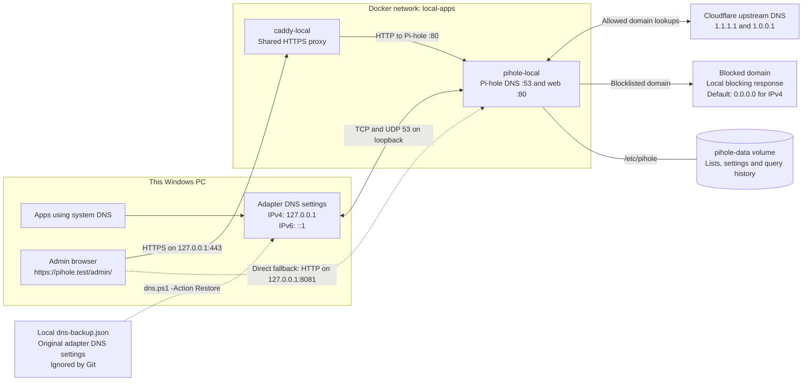

# Pi-hole Local

Pi-hole in Docker for **this Windows PC only**. DNS is published on IPv4 and IPv6 loopback; the router and other devices are unchanged. Shared HTTPS belongs to [Caddy Local](https://github.com/rohandhamapurkar/caddy-local), independently of this stack.

## Architecture



DNS filtering and dashboard access are separate paths: DNS never passes through Caddy, and stopping Caddy does not stop filtering. All published Pi-hole ports are loopback-only, so the router and other devices are unaffected. The hosts file resolves `pihole.test` locally for the dashboard. Custom browser Secure DNS and VPN DNS can bypass the system resolver. Keep Pi-hole running while the adapter points to localhost, or restore the saved DNS settings first.


## Requirements

- Windows, Docker Desktop with Linux containers, Docker Compose, and PowerShell.
- Available local TCP/UDP port 53 on `127.0.0.1` and `::1`, plus TCP port 8081.
- Administrator access to change this PC's DNS settings.
- Optional Caddy Local for trusted HTTPS; DNS and the direct localhost dashboard work without it.

## Install and start

```powershell
git clone https://github.com/rohandhamapurkar/pihole-local.git pihole-local
cd pihole-local
powershell -NoProfile -ExecutionPolicy Bypass -File .\initialize.ps1
docker compose up -d
```

The initializer creates the shared external `local-apps` Docker network if absent and generates a private `.env` file with a random `PIHOLE_PASSWORD`. Existing credentials are preserved. Open `.env` locally to find the admin password; do not commit it.

- Direct dashboard: http://localhost:8081/admin/
- Trusted HTTPS with [Caddy Local](https://github.com/rohandhamapurkar/caddy-local): https://pihole.test/admin/

For HTTPS, run Caddy Local's setup separately. Its hosts helper maps `pihole.test` to localhost and its trust helper installs the local CA. This stack joins `local-apps` as `pihole`, allowing Caddy to proxy to port 80. Pi-hole's internal port 443 is not published.

## Verify before changing Windows DNS

```powershell
Resolve-DnsName example.com -Server 127.0.0.1 -Type A -DnsOnly
Resolve-DnsName example.com -Server ::1 -Type A -DnsOnly
docker compose exec -T pihole pihole status
```

Wait for the container to be healthy and both queries to succeed. If a DNS port is occupied, identify the owner before changing or stopping system networking services.

## Enable filtering for this PC

In an **administrator PowerShell**, change to this repository's folder and run:

```powershell
powershell -NoProfile -ExecutionPolicy Bypass -File .\dns.ps1 -Action Enable
```

The helper tests both local resolvers, backs up DNS settings for currently active physical adapters with IPv4 default routes, then sets IPv4 DNS to `127.0.0.1` and IPv6 DNS to `::1`. It preserves the original `dns-backup.json` on repeated runs and attempts restoration if activation fails. The saved backup applies only to adapters captured during the first run; inspect new adapters separately.

Verify a normal domain and a known advertising domain, for example:

```powershell
Resolve-DnsName example.com -Type A -DnsOnly
Resolve-DnsName doubleclick.net -Type A -DnsOnly
```

With the current default list, `doubleclick.net` returns `0.0.0.0`. Blocklists change over time; inspect Pi-hole's query log and lists if results differ.

This does not modify the router, disconnected adapters, VPN adapters, or virtual switches. Browser custom Secure DNS and VPN DNS may bypass filtering. Configure browsers to use system DNS. Pi-hole filters domains and cannot reliably block ads served from the same hostname as content; a browser content blocker complements it.

## Restore DNS before stopping Pi-hole or Docker

While the adapter points to localhost, Docker and Pi-hole must stay running. In administrator PowerShell, from this folder:

```powershell
powershell -NoProfile -ExecutionPolicy Bypass -File .\dns.ps1 -Action Restore
```

This restores automatic or static DNS per address family from `dns-backup.json`. Then stop the container with `docker compose stop`. As a recovery option, open Windows adapter DNS settings and restore the original settings recorded in the backup. If the original mode was automatic, restore automatic DNS.

## Management and data

- Status: `docker compose ps`
- Logs: `docker compose logs --tail 100`
- Refresh blocklists: `docker compose exec -T pihole pihole -g`
- Update: `docker compose pull`, then `docker compose up -d`
- Persistent configuration, lists and query history: Docker volume `pihole-local_pihole-data`.
- Remove containers without data: `docker compose down`, after restoring host DNS.

Keep `.env`, DNS backups, logs, and Docker volume contents private. They are excluded by `.gitignore`. This repository contains deployment configuration and Windows helper scripts, not Pi-hole source code. Host DNS automation is Windows-only; this repository does not configure macOS host DNS.

The container uses Cloudflare's `1.1.1.1` and `1.0.0.1` as upstream resolvers. Its bootstrap DNS is explicitly configured to avoid depending on its own localhost service.

The current Windows deployment was verified with IPv4/IPv6 resolution, domain blocking, dashboard authentication, and a successful restore/re-enable cycle.

Official reference: https://docs.pi-hole.net/docker/
